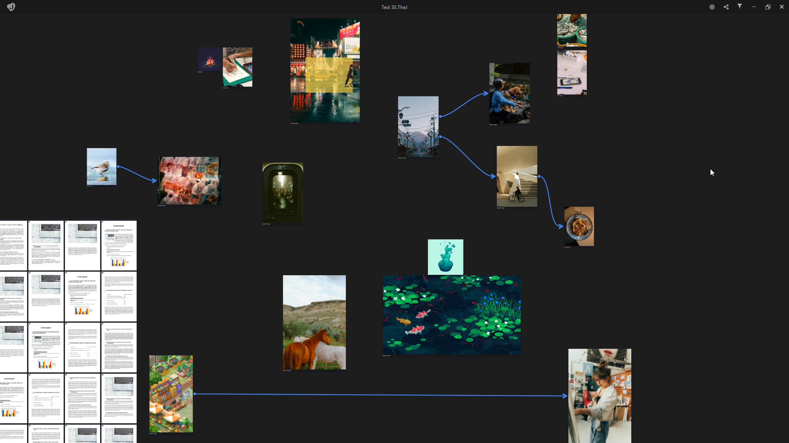

  

<h1 align="center">TheJ</h1>

<b>The infinite reference board for artists. Fast, local-first and private.</b>

  
  
  
  

  

---

## Why TheJ?

Collect references, mood boards and visual ideas on one endless canvas. TheJ keeps your boards **on your own computer**, with no account, no cloud and no tracking.

## Features

- **Infinite canvas.** Drop in images, GIFs, videos, PDFs, SVGs, PSDs and 3D models.
- **Crop in a second.** Hold **C**, scroll for ratios, drag edges or corners.
- **Smart snapping.** Edge and centre guides, plus equal-spacing snap.
- **Notes and comments.** Rich-text notes, comments and video annotations.
- **Compare.** A/B compare and a hex colour palette from your images.
- **Local-first.** Boards are single `.thej` files you own.
- **Live collaboration (beta).** Share a board with a code, end-to-end encrypted.

## Download

| Platform | Get it |
|---|---|
| Windows | [Installer (.exe)](https://github.com/Stronm/TheJ/releases/latest) · [Microsoft Store](https://apps.microsoft.com/detail/9P40V60LP6GK?hl=en-us&gl=IN&ocid=pdpshare) |
| Linux (x64) | Portable `.tar.gz` on the [Releases](https://github.com/Stronm/TheJ/releases) page |

## Quick start

1. Install and open TheJ.
2. Drag images onto the canvas, or click **Browse**.
3. Hold **C** on an image to crop. Press **`** for shortcuts and guides.
4. Save your board as a `.thej` file.

## Privacy

Everything stays on your device. Online collaboration is optional and end-to-end encrypted. Read the full [privacy policy](PRIVACY.html).

## Feedback

Found a bug or have an idea? [Open an issue](https://github.com/Stronm/TheJ/issues) or email **connetthej@gmail.com**.

---

Made by <b>Saanu John</b> · © 2026

